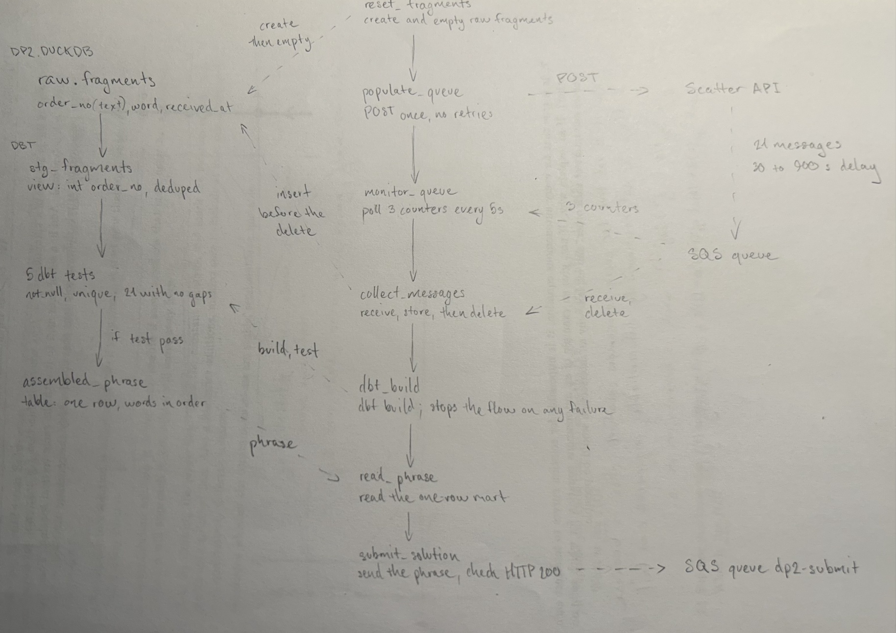
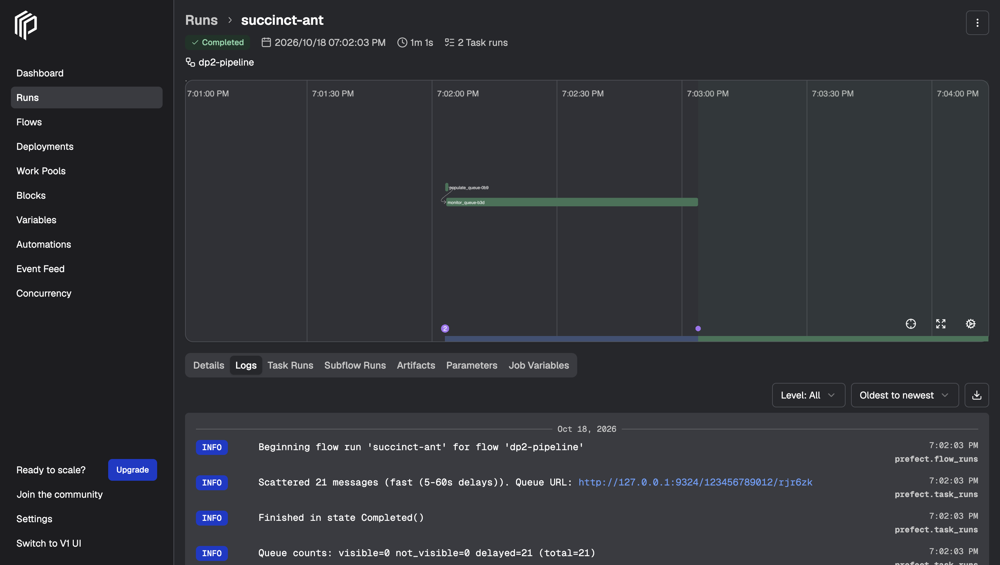
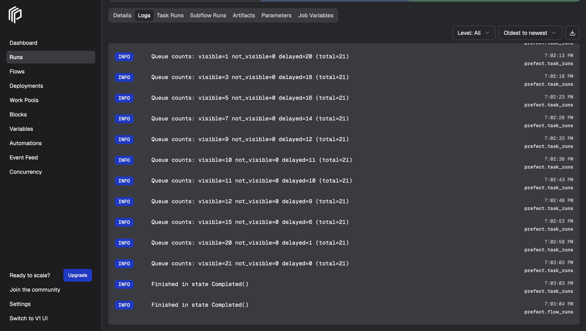
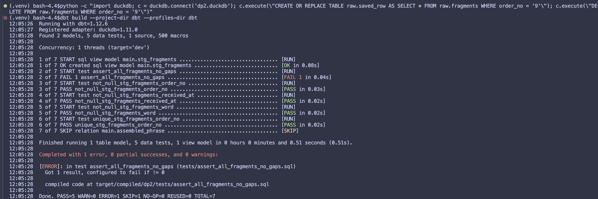
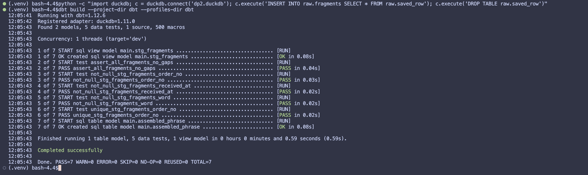

# DS 3022 Data Project 2 (Fall 2026): The SQS Puzzle

## My Pipeline

### Pipeline DAG

The seven Prefect tasks run top to bottom in this order. Dashed lines show what each task reads from or writes to: DuckDB and dbt on the left, the scatter API and the SQS queues on the right.



### Polling strategy (Checkpoint A)

**What I chose:** after the single POST to the scatter API, `monitor_queue` calls `get_queue_attributes` every 5 seconds and logs the three counters (visible, not visible, delayed). It waits until `ApproximateNumberOfMessagesDelayed` reaches 0, and only then lets the flow move on to collecting.

**Why:**
- The delays are random, so the delayed counter reaching 0 is the one signal that every message can now be received.
- One small API call every 5 seconds is cheap, and the flow waits at most 5 seconds longer than it has to.
- The timeout is 1200 seconds, above the 900-second maximum delay. A healthy run always finishes, and a broken one fails with a clear error naming how many messages are still delayed, not a hang.
- Every poll is logged, so the Prefect dashboard shows the queue moving from delayed to visible. In fast mode (5-60 second delays) this takes about a minute.

**What I rejected:**
- **A fixed `sleep(900)`:** it always waits the worst case, even in fast mode, and it says nothing if messages go missing.
- **Receiving in a loop without watching the counters:** an empty response looks the same whether messages are still delayed or the queue is drained, so the loop could not tell "wait longer" from "something is lost".
- **Retrying the POST when the queue looks slow:** every POST empties the queue and sends all 21 messages again, so `populate_queue` runs once per run with no retries.

**Evidence:** a completed run from Checkpoint A, when the flow had only `populate_queue` and `monitor_queue`:



The same run's log, with the delayed count falling to 0, polled every 5 seconds:



### Receive, store, then delete (Checkpoint B)

**How it works:** `collect_messages` asks for up to 10 messages at a time with `MessageAttributeNames=["All"]`, waiting up to 5 seconds when none are visible. An empty response has no `Messages` key, so it reads `resp.get("Messages", [])`. For each message it reads `order_no` and `word` from the attributes' `StringValue`, inserts them into `raw.fragments` in DuckDB, and only then deletes the message with its `ReceiptHandle`. It stops when 21 distinct order numbers are stored and all three queue counters are 0. If that hasn't happened after 120 seconds, it raises an error saying how many fragments arrived and how many messages are left.

**Why this order:** a message is deleted only after its fragment is stored, so a failure can never lose a fragment. The worst case is storing one twice.

**If the flow crashes between steps:**
- **After receiving, before storing:** the message was never deleted, so it stays in the queue and becomes visible again after the queue's 30-second visibility timeout. Nothing is lost.
- **After storing, before deleting:** the fragment is in DuckDB, and the message comes back after 30 seconds and can be stored a second time. That's why duplicates are expected and removed later: `collect_messages` counts distinct order numbers, and the dbt staging model keeps one row per order number.
- **Rerunning after a crash:** every run starts with `reset_fragments`, which empties `raw.fragments`, because the POST right after it empties the queue and starts a fresh puzzle. Rows left from an older run could otherwise hide a fragment missing from this one. Emptying happens in its own task, so `collect_messages` only ever adds rows and can't lose any.

**Malformed messages:** a message missing `order_no` or `word` can't be a fragment, so it's logged as a warning and deleted without being stored. It can't crash the loop or be left in the queue.

**Tested:** a queue with 21 fragments, 2 duplicate copies and 2 malformed messages ended with 21 fragments stored, the duplicates counted once, both malformed messages deleted, and all counters at 0. With only 20 fragments, or an empty queue, it stopped with the timeout error instead of hanging.

### dbt quality gate (Checkpoint C)

**Models:**
- **`stg_fragments`** (a view): casts `order_no` to an integer, trims `word`, drops rows that can't be a fragment (a non-numeric order number, a missing or blank word), and keeps the first-received copy of each order number, so a duplicated raw row counts once.
- **`assembled_phrase`** (a table): one row with the words joined in `order_no` order. Sorting by the integer matters, because as strings "10" would sort before "2".

**Tests:**
- **Generic tests** in `schema.yml`: `not_null` and `unique` on `order_no`, and `not_null` on `word` and `received_at`.
- **Singular test** `tests/assert_all_fragments_no_gaps.sql`: fails unless there are exactly 21 fragments with 21 distinct order numbers, the lowest 1 and the highest 21. 21 distinct numbers from 1 to 21 can't have a gap.

**How the gate stops a bad phrase:** `dbt build` runs the tests on `stg_fragments` before it builds `assembled_phrase`. If any test fails, dbt skips the mart and exits with an error, `dbt_build` raises, and the flow stops before `read_phrase`, so nothing is submitted. dbt runs as a separate process with the command `dbt build --project-dir dbt --profiles-dir dbt`, and its output is copied into the Prefect log so it shows in the dashboard. I first ran dbt inside the flow's own process, but that replaced Prefect's log handler and dropped the task names from the logs.

**Proof the tests can fail:** deleting one fragment from `raw.fragments` made `assert_all_fragments_no_gaps` fail and dbt skip `assembled_phrase`. Restoring it brought all 7 back to PASS. Duplicating a row still passed, because staging removes the duplicate.

Fragment 9 deleted, so the singular test fails and `assembled_phrase` is skipped:



Fragment 9 restored, so all 7 pass and `assembled_phrase` is built:



### Submission (Checkpoint D)

`submit_solution` runs only after `dbt_build` and `read_phrase` succeed. It looks up the `dp2-submit` queue and sends one message whose attributes carry `uvaid` (read from `.env`), the phrase from `assembled_phrase`, and `platform` set to `prefect`. It checks the HTTP status of the response, raises if it isn't 200, and logs the status with the message ID.

**Receipt code:** `BA6C223CE4`

Check it with `python kit/check_submission.py --verify rjr6zk prefect BA6C223CE4`, which prints `VALID receipt`.

## Assignment

This data project is a puzzle. Your goal is to put the pieces back together in the right order.

You will write a **Prefect** data pipeline that retrieves 21 messages from an SQS queue, parses their contents, and reassembles a complete phrase from the fragments, one word per message. Your pipeline can run a single time to produce a complete result, or it can run on a schedule. Design your workflow however you see fit. You can run it as many times as you like while testing.

> Adapted from Neal Magee's Fall 2025 Data Project 2 (UVA). The puzzle is the same. Two things are new this year:
> 1. **The queue runs on your laptop.** A free SQS emulator replaces AWS, so you need no AWS account or credentials. Your code is still ordinary `boto3`: one environment variable (`AWS_ENDPOINT_URL_SQS`) decides whether it talks to your laptop or to real AWS.
> 2. **dbt is the quality gate.** Fragments are landed in DuckDB, and a dbt model reassembles the phrase. dbt tests must pass before your flow is allowed to submit.

**Due:** Monday 19 October 2026, **23:59** (Lesson 11 that afternoon is a working session: evidence run, chaos round and independent build time with instructor help). **Weight:** 20%.

Before anything else, follow **[SETUP.md](SETUP.md)** until `python kit/smoke_test.py` prints `Emulator OK`. SETUP.md also explains the four terminals you keep open while you work.
Work through **[CHECKPOINTS.md](CHECKPOINTS.md)**, check your work against **[RUBRIC.md](RUBRIC.md)**, and keep **[PROGRESS.md](PROGRESS.md)** up to date.

## Architecture

```
POST /api/scatter/<UVA_ID>          (kit/scatter_api.py, your laptop)
        |
        v
SQS queue <UVA_ID>  -- 21 messages, each delayed 30-900 s --
        |
        v
Prefect flow  (prefect-flow.py)
   monitor counters -> receive -> land in DuckDB raw.fragments -> delete
        |
        v
dbt build  (dbt/)
   stg_fragments (typed, de-duplicated) -> tests -> assembled_phrase
        |
        v
send_message to queue dp2-submit  ->  python kit/check_submission.py  ->  receipt code
```

## Task 1: Populate your SQS queue

Make an HTTP `POST` request to the scatter API with your UVA computing ID (the scatter API must be running, see SETUP.md):

```
http://127.0.0.1:8000/api/scatter/<UVA_ID>
```

```python
import requests

url = "http://127.0.0.1:8000/api/scatter/mst3k"
payload = requests.post(url).json()
```

```python
import httpx

url = "http://127.0.0.1:8000/api/scatter/mst3k"
payload = httpx.post(url).json()
```

The response gives you your queue URL:

```
>>> payload
{'hello': 'mst3k', 'sqs_url': 'http://127.0.0.1:9324/123456789012/mst3k', 'messages': 21, 'mode': 'fast (5-60s delays)'}
```

Your request sends exactly **21** messages to your queue, each with a random `DelaySeconds` between **30 and 900 seconds** (5 to 60 seconds while `DP2_FAST=1`, for development). **Keep these delays in mind as your pipeline proceeds to the next task.**

**NOTE:** Do not repeat this POST if your pipeline runs more than once (for example on a schedule) or inside a retry loop. Each POST empties your queue and sends all 21 messages again.

## Task 2: Monitor your queue, then collect, land and delete

Track how many messages are waiting with `get_queue_attributes()`. Three values count messages, and together they make up the total:

- `ApproximateNumberOfMessages` (visible, ready to receive)
- `ApproximateNumberOfMessagesNotVisible` (received by someone, not yet deleted)
- `ApproximateNumberOfMessagesDelayed` (still hidden by their delay)

Decide on a strategy for how and when to pick up messages, explain it in your README, and code it.

Each message has a `Body` containing the same meaningless word. The meaningful content is in `MessageAttributes`. Ask for it explicitly with `MessageAttributeNames=["All"]`, then read each attribute's `StringValue`:

```python
msg = resp["Messages"][0]
order_no = msg["MessageAttributes"]["order_no"]["StringValue"]   # a string, not an int
word     = msg["MessageAttributes"]["word"]["StringValue"]
```

Requirements:

- **Land every fragment in DuckDB** (default file `dp2.duckdb`, table `raw.fragments` with at least `order_no`, `word`, `received_at`) **before** you delete its message.
- Delete each message with its `ReceiptHandle` after storing it. Your pipeline must receive, store and delete **all** messages. Leave no "dangling" messages behind.
- Handle empty or delayed responses gracefully. When nothing is visible, `receive_message` returns a response **without** a `Messages` key; your pipeline must not crash on it.
- Use a timeout so the pipeline fails clearly, rather than hanging forever, if fragments never arrive.

## Task 3: Reassemble with dbt, then submit

Build the phrase with dbt inside `dbt/` (the project, profile and source are already set up):

- `models/staging/stg_fragments.sql`: cast `order_no` to an integer and clean `word`. Make this robust to a fragment being stored twice.
- `models/staging/schema.yml`: generic tests (`not_null`, `unique`, ...) on its columns.
- `tests/`: at least one singular test that fails unless there are exactly 21 fragments with no gaps in the order numbers.
- `models/marts/assembled_phrase.sql`: one row containing the phrase in order.

Your flow runs `dbt build --project-dir dbt --profiles-dir dbt` (or `dbtRunner` from `dbt.cli.main`) and **must not submit if dbt fails**.

Example of ordering:

```
order_no   word
--------   -----
3          brown
2          quick
4          fox.
1          The
```

gives "The quick brown fox."

Submit your phrase as a message to the separate queue **`dp2-submit`**, with your computing ID and the platform used (`"prefect"`) as message attributes:

```python
def send_solution(uvaid, phrase, platform):
    url = sqs.get_queue_url(QueueName="dp2-submit")["QueueUrl"]
    response = sqs.send_message(
        QueueUrl=url,
        MessageBody="dp2 solution",
        MessageAttributes={
            "uvaid":    {"DataType": "String", "StringValue": uvaid},
            "phrase":   {"DataType": "String", "StringValue": phrase},
            "platform": {"DataType": "String", "StringValue": platform},
        },
    )
    ...
```

Check and log that the response has HTTP status `200`. Then run:

```
python kit/check_submission.py
```

and paste the **receipt code** it prints into your README.

You may observe and rerun your pipeline as often as you like, but in the end your code must fetch, store, test, reassemble and submit without human intervention. You may not receive messages or sort fragments by hand.

## Notes and submission

1. Fork the assignment repository and push your work to your fork.
2. Your Prefect flow lives in `prefect-flow.py`. Secondary flows (subflows) are allowed.
3. Use Prefect's built-in logging. Do not commit log files.
4. Do not commit data, `.duckdb` files, `dbt/target/` or `.env` (the provided `.gitignore` handles this).
5. Do not edit the files in `kit/`: they are the same for everyone and are used to check your submission.
6. Your **README must include**: how to set up and run your pipeline; your polling strategy and why; how your dbt tests protect the result (with a screenshot of a test failing on purpose and then passing); a Prefect dashboard screenshot of one **full-delay run** (`DP2_FAST=0`); your receipt code; and a "Chaos round" section (Lesson 11).
7. Submit the repository link and your self-assessed **[RUBRIC.md](RUBRIC.md)**. Your README is where you explain and defend your design (25% of the grade).

## Reference

- [Working with SQS: practical examples (Neal Magee)](https://github.com/nmagee/learn-sqs)
- [boto3 SQS client documentation](https://boto3.amazonaws.com/v1/documentation/api/latest/reference/services/sqs.html)
- [Prefect documentation](https://docs.prefect.io/v3/get-started)
- [dbt-duckdb adapter](https://github.com/duckdb/dbt-duckdb) and [dbt data tests](https://docs.getdbt.com/docs/build/data-tests)
- [Moto server mode](https://docs.getmoto.org/en/latest/docs/server_mode.html), [ElasticMQ](https://github.com/softwaremill/elasticmq)
